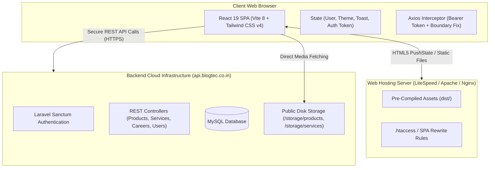
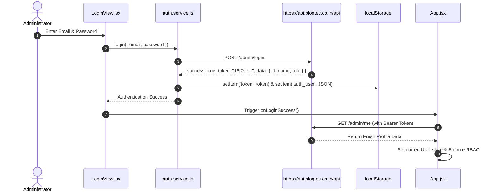

# BLOGTECH Enterprise Admin Panel — Complete Technical & Operating Documentation

Welcome to the definitive architectural, operational, and development documentation for the **BLOGTECH Admin Panel**. This document serves as the master reference manual for engineers, administrators, client stakeholders, and DevOps teams.

---

## 📑 Master Table of Contents
1. [Executive Summary & System Architecture](#1-executive-summary--system-architecture)
2. [Technology Stack & Dependencies](#2-technology-stack--dependencies)
3. [Project Directory & File Structure](#3-project-directory--file-structure)
4. [Authentication & Session Lifecycle](#4-authentication--session-lifecycle)
5. [Role-Based Access Control (RBAC)](#5-role-based-access-control-rbac)
6. [Core Modules & Component Reference](#6-core-modules--component-reference)
   - [6.1 Dashboard Module](#61-dashboard-module)
   - [6.2 Products Catalog Module](#62-products-catalog-module)
   - [6.3 Services Catalog Module](#63-services-catalog-module)
   - [6.4 Careers & Vacancies Module](#64-careers--vacancies-module)
   - [6.5 Blog Publications Module](#65-blog-publications-module)
   - [6.6 Settings & Access Control Module](#66-settings--access-control-module)
7. [Shared UI Component Library](#7-shared-ui-component-library)
8. [API Services & Integration Layer](#8-api-services--integration-layer)
9. [Media Upload & Image Processing Pipeline](#9-media-upload--image-processing-pipeline)
10. [Routing, State Management & Event System](#10-routing-state-management--event-system)
11. [Build, Deployment & Server Configuration](#11-build-deployment--server-configuration)
12. [Maintenance, Troubleshooting & FAQ](#12-maintenance-troubleshooting--faq)

---

## 1. Executive Summary & System Architecture

The **BLOGTECH Admin Panel** is a cloud-ready, responsive enterprise single-page application (SPA) engineered to manage corporate marketing solutions, software products, corporate service offerings, career vacancies, and technical blog publications.



### Key Architectural Characteristics:
* **Decoupled Architecture**: 100% headless static frontend communicating strictly via RESTful JSON and multipart APIs with the Laravel backend.
* **Atomic Media Operations**: Product and service updates handle metadata, featured images, and photo galleries atomically in single HTTP requests.
* **Strict Role-Based Access Control (RBAC)**: Fine-grained permissions enforced across navigation, URL routing, UI buttons, and data views.
* **Fail-Safe Media Resolvers**: Intelligent image loading pipeline that resolves backend domain discrepancies, supports streaming fallback, and generates responsive offline SVG placeholders.

---

## 2. Technology Stack & Dependencies

| Layer | Technology | Version | Purpose |
| :--- | :--- | :--- | :--- |
| **Runtime / Library** | React | `^19.2.8` | Declarative UI component architecture with hooks |
| **DOM Renderer** | React DOM | `^19.2.8` | Client DOM rendering & reconciliation |
| **Build Engine** | Vite | `^8.3.0` | Ultra-fast HMR and Rollup production asset compiler |
| **Vite React Plugin**| `@vitejs/plugin-react` | `^6.1.1` | Fast Refresh and JSX transformation |
| **Styling** | Tailwind CSS | `^4.3.3` | Utility-first styling engine with CSS variables |
| **Tailwind Vite** | `@tailwindcss/vite` | `^4.3.3` | Vite compilation integration for Tailwind v4 |
| **HTTP Client** | Axios | `^1.20.0` | Promise-based HTTP client with request/response interceptors |
| **Iconography** | Lucide React | `^1.52.0` | Modern, lightweight SVG vector icons |
| **Notifications** | React Hot Toast | `^2.6.1` | Toast alert system provider |

---

## 3. Project Directory & File Structure

```
admin-panel/
├── public/                         # Public static files copied verbatim to dist/
│   ├── .htaccess                   # Apache / LiteSpeed SPA rewrite rules & caching headers
│   ├── fav-icon.jpg                # Browser tab shortcut favicon
│   └── MAIN-LOGO.png               # Primary corporate logo
├── src/
│   ├── components/
│   │   ├── layout/                 # Application frame components
│   │   │   ├── Header.jsx          # Sticky header with search, breadcrumb & user dropdown
│   │   │   ├── Layout.jsx          # Master responsive layout container
│   │   │   └── Sidebar.jsx         # Collapsible desktop sidebar & mobile drawer
│   │   ├── ui/                     # Reusable design system UI components
│   │   │   ├── Avatar.jsx          # User & image avatars with online status indicator
│   │   │   ├── Badge.jsx           # Status & tag pills (Active, Published, Draft, Closed)
│   │   │   ├── Breadcrumb.jsx      # Hierarchical navigation breadcrumb
│   │   │   ├── Button.jsx          # Standardized buttons with icons, loading & variants
│   │   │   ├── CommandPalette.jsx  # Global Cmd+K quick launcher and navigation modal
│   │   │   ├── ConfirmDialog.jsx   # Deletion and destructive action confirmation modal
│   │   │   ├── DatePicker.jsx      # Styled HTML5 date selector
│   │   │   ├── DropdownMenu.jsx    # Popover contextual menu
│   │   │   ├── FormField.jsx       # Standard form wrapper with label, error & hint
│   │   │   ├── ImageUploader.jsx   # Drag-and-drop file upload zone
│   │   │   ├── Modal.jsx           # Generic accessible dialog container
│   │   │   ├── RichTextEditor.jsx  # Word-style WYSIWYG formatted content editor
│   │   │   ├── Select.jsx          # Custom styled dropdown select element
│   │   │   ├── Skeleton.jsx        # Animated shimmer loading placeholders
│   │   │   ├── Table.jsx           # Sortable, paginated data table component
│   │   │   └── ToastContext.jsx    # Application-wide toast alert provider & hooks
│   │   └── views/                  # Primary functional modules
│   │       ├── auth/
│   │       │   └── LoginView.jsx   # Administrative credentials login screen
│   │       ├── blogs/
│   │       │   ├── BlogsView.jsx   # Blog articles list, filtering, and preview mode
│   │       │   └── CreateBlog.jsx  # Article editor with rich text, SEO, & dynamic author
│   │       ├── careers/
│   │       │   ├── CareersView.jsx # Job openings list and filter controls
│   │       │   └── CreateCareer.jsx# Job editor with text inputs & enum normalization
│   │       ├── dashboard/
│   │       │   └── DashboardView.jsx # KPI cards, recent vacancy & publication tables
│   │       ├── enquiries/
│   │       │   └── EnquiriesView.jsx # Customer enquiries and contact leads list
│   │       ├── products/
│   │       │   ├── CreateProduct.jsx # Product editor (atomic featured image & gallery)
│   │       │   ├── ProductsView.jsx  # Product catalog cards/table with live status toggle
│   │       │   └── ViewDetails.jsx   # Product specification modal viewer
│   │       ├── service/
│   │       │   ├── CreateService.jsx # Service editor with featured media & deliverables
│   │       │   └── ServiceList.jsx   # Corporate services list & publish controls
│   │       └── settings/
│   │           └── SettingsView.jsx  # Profile, Security, User Admin & RBAC Matrix
│   ├── utils/                      # Core business logic, APIs, and helpers
│   │   ├── auth.service.js         # Authentication, session tokens, user storage
│   │   ├── career.service.js       # Careers REST API service
│   │   ├── image.helper.js         # URL normalization, domain fallback & SVG placeholders
│   │   ├── main.service.js         # Axios instance, interceptors, base API configuration
│   │   ├── ourservice.service.js   # Services REST API service
│   │   ├── product.service.js      # Products REST API service
│   │   ├── rbac.helper.js          # Role-Based Access Control logic & allowed tabs
│   │   └── user.service.js         # Admin user management, roles & permissions API
│   ├── App.jsx                     # Root application coordinator, routing, and RBAC guards
│   ├── index.css                   # Tailwind v4 directives, color themes & custom classes
│   ├── main.jsx                    # Application entry point with React 19 root
│   └── mockData.js                 # Fallback seed data for initial rendering
├── dist/                           # Production compiled output directory
├── dist.zip                        # Pre-packaged production deployment zip archive
├── DEPLOYMENT_GUIDE.md             # Client deployment manual for server operations
├── package.json                    # Project metadata, scripts, and dependencies
└── vite.config.js                  # Vite configuration with React & Tailwind plugins
```

---

## 4. Authentication & Session Lifecycle

The admin panel utilizes **Laravel Sanctum Bearer Token** authentication.



### Storage Keys & Utilities (`src/utils/auth.service.js`):
* `token` / `auth_token`: Raw Sanctum plain-text bearer token string.
* `auth_user`: Serialized JSON object containing `{ id, name, email, role, status }`.
* **Automatic Token Injection**: The Axios request interceptor in `main.service.js` automatically inspects `localStorage` and appends `Authorization: Bearer <token>` to all outgoing requests.
* **Global 401 Expiration Listener**: If the backend returns `401 Unauthorized` or `403 Forbidden` (due to token revocation or expiration):
  1. `localStorage` authentication keys are purged.
  2. A global `window.dispatchEvent(new Event('auth:unauthorized'))` is fired.
  3. `App.jsx` catches the event, resets `isAuthenticated` to `false`, and redirects the user to the login screen with an expiration toast.

---

## 5. Role-Based Access Control (RBAC)

Access to admin panel modules is strictly controlled by the authenticated user's `role` property (`super_admin`, `admin`, or `editor`).

### Access Permission Matrix:

| Administrative Module | Super Admin (`super_admin`) | Admin (`admin`) | Editor (`editor`) |
| :--- | :---: | :---: | :---: |
| **Dashboard (`/`)** | ✅ View Metrics & Logs | ✅ View Metrics & Logs | ✅ View Metrics & Logs |
| **Products Catalog (`/products`)** | ✅ Full CRUD & Publish | ✅ Full CRUD & Publish | ❌ Restricted (Hidden) |
| **Services Catalog (`/services`)** | ✅ Full CRUD & Publish | ✅ Full CRUD & Publish | ❌ Restricted (Hidden) |
| **Careers & Jobs (`/careers`)** | ✅ Full CRUD & Publish | ✅ Full CRUD & Publish | ✅ Full CRUD & Publish |
| **Blogs & Articles (`/blogs`)** | ✅ Full CRUD & Publish | ✅ Full CRUD & Publish | ✅ Full CRUD & Publish |
| **Personal Profile (`/settings`)** | ✅ Update Name & Email | ✅ Update Name & Email | ✅ Update Name & Email |
| **Change Password (`/settings`)** | ✅ Update Password | ✅ Update Password | ✅ Update Password |
| **Administrator Users (`/settings`)**| ✅ Full User Management| ❌ No Access | ❌ No Access |
| **System Roles & Permissions** | ✅ View Full Matrix | ❌ No Access | ❌ No Access |

### RBAC Enforcement Architecture (`src/utils/rbac.helper.js`):
1. **Sidebar Navigation**: `Sidebar.jsx` filters `navSections` with `canAccessTab(user?.role, item.id)`. Modules not permitted for the role are omitted from the DOM.
2. **Command Palette (`Cmd + K`)**: `CommandPalette.jsx` filters search results and quick actions matching role capabilities.
3. **Route Guarding**: In `App.jsx`, `setActiveTab(tab)` rejects unauthorized navigation attempts and displays a warning toast.
4. **Direct URL Protection**: If an editor visits `/products` directly via address bar or bookmark, an active `useEffect` immediately redirects the browser to `/dashboard`.
5. **Fail-Safe View Boundary**: If an unauthorized view is invoked, `AccessDeniedNotice` renders an alert preventing unauthorized API dispatching.

---

## 6. Core Modules & Component Reference

### 6.1 Dashboard Module
* **Component**: `src/components/views/dashboard/DashboardView.jsx`
* **Purpose**: Primary mission control providing real-time visibility into content velocity, career vacancies, and recent activity logs.
* **Key Features**:
  * **Top Metrics**: Active Careers count, Total Careers count, Published Blogs count, and Draft Blogs count.
  * **Recent Vacancies Table**: Displays the 5 most recent job listings with live status badges and direct management navigation.
  * **Recent Publications Table**: Displays the 5 most recent blog articles with thumbnail previews, category pills, and quick edit links.
  * **Quick Actions Panel**: Direct modal launchers for "Add Job Opening" and "Create Blog Article".
  * **Activity Feed**: Live timeline indicating recent publishing and administrative events.

---

### 6.2 Products Catalog Module
* **Components**: 
  * `ProductsView.jsx` — Product catalog management, search, status filtering, table/card toggle.
  * `CreateProduct.jsx` — Unified product creator & editor with atomic media uploads.
  * `ViewDetails.jsx` — Product inspection modal with photo gallery lightbox.
* **Service**: `src/utils/product.service.js`
* **Data Fields**:
  * `name` (string, required): Product commercial title.
  * `slug` (string, required): URL slug (auto-generated from title if blank).
  * `short_description` (text): Concise summary snippet.
  * `description` (text): Detailed overview of software capabilities.
  * `content` (HTML): Word-style rich text specifications, architecture, and features.
  * `status` (`published` | `draft` | `unpublished`): Catalog visibility status.
  * `sort_order` (integer): Display precedence rank.
  * `published_at` (date): Scheduled or live release date.
  * `meta_title` & `meta_description`: Search engine optimization tags with Google SERP live snippet preview.
  * `featured_image` (file): Primary thumbnail asset.
  * `gallery_images[]` (files array): High-resolution application screenshots and diagrams.
* **Atomic Media Upload Design**:
  * Unlike legacy systems requiring multiple round-trips, creating or updating a product sends metadata, the featured image file, and gallery image files in a single unified `multipart/form-data` payload.
  * Drag-and-drop file upload zones are integrated with local blob previews (`URL.createObjectURL`).

---

### 6.3 Services Catalog Module
* **Components**:
  * `ServiceList.jsx` — Services grid with active publish toggles and category filters.
  * `CreateService.jsx` — Corporate service offering form.
* **Service**: `src/utils/ourservice.service.js`
* **Key Features**:
  * Captures technical deliverables, architecture overviews, and enterprise capabilities.
  * Supports featured graphic uploading with real-time preview and replacement.
  * Quick status management via `PATCH /admin/services/:id/publish`.

---

### 6.4 Careers & Vacancies Module
* **Components**:
  * `CareersView.jsx` — Job vacancies list, department filters, employment type filters.
  * `CreateCareer.jsx` — Vacancy creator and editor.
* **Service**: `src/utils/career.service.js`
* **Key Features**:
  * **Text Input Flexibility**: Department and Employment Type operate as free-text input fields (`<input type="text" />`) with automatic value normalization:
    * Inputs such as `"Full Time"`, `"full-time"`, `"Permanent"` smoothly normalize to backend-validated enum values (`full_time`, `part_time`, `contract`, `internship`).
  * Comprehensive career parameters: Salary range, physical/remote location, required experience, candidate requirements, and role perks.

---

### 6.5 Blog Publications Module
* **Components**:
  * `BlogsView.jsx` — Blog posts table, category filters, and public website simulator.
  * `CreateBlog.jsx` — WYSIWYG article editor.
* **Key Features**:
  * **Dynamic Author Resolution**: The author field dynamically resolves to the authenticated administrator (`currentUser?.name || getStoredUser()?.name`).
  * **Word-Style Content Editor**: Powered by `RichTextEditor.jsx`, supporting headings, bold, italic, underline, bullet lists, ordered lists, blockquotes, and code snippets.
  * **Public Preview Simulator**: Allows editors to preview the exact rendering of the article, banner image, and author information before releasing to production.

---

### 6.6 Settings & Access Control Module
* **Component**: `src/components/views/settings/SettingsView.jsx`
* **Service**: `src/utils/user.service.js`
* **Sub-Sections**:
  1. **Profile Details (`PUT /admin/profile`)**:
     * Live name and email editing.
     * Updates header avatar, user initials, and local storage immediately upon save.
  2. **Security & Credentials (`PUT /admin/change-password`)**:
     * Password update with validation for current password, new password, and password confirmation matching.
  3. **Administrator Users (`GET /admin/users` — Super Admin Only)**:
     * Lists all administrators with role badges and active/inactive status pills.
     * **Add Administrator**: Modal for creating accounts with name, email, role selection, and temporary password.
     * **Edit Administrator**: Modal for modifying user names, emails, and roles (`PUT /admin/users/:id`).
     * **Status Toggle**: One-click activation/deactivation (`PATCH /admin/users/:id/status`).
     * **Delete Administrator**: Protected deletion dialog with safeguards preventing the deletion of the active super admin.
  4. **Roles & Permissions (`GET /admin/roles`, `GET /admin/permissions` — Super Admin Only)**:
     * Interactive visualization of the system RBAC permission matrix.
     * Grouped by functional modules (Products, Services, Blogs, Careers, Dashboard, Users) displaying role access tags.

---

## 7. Shared UI Component Library

All UI components reside in `src/components/ui/` and follow consistent styling guidelines:

| Component | Props | Description |
| :--- | :--- | :--- |
| `Button.jsx` | `variant`, `size`, `icon`, `iconPosition`, `isLoading`, `fullWidth` | Standard interactive button supporting `primary`, `secondary`, `accent`, `danger`, `ghost` styles. |
| `Avatar.jsx` | `name`, `image`, `size`, `status`, `showStatus` | Color-hashed user avatar with fallback initials and status badge. |
| `Badge.jsx` | `status`, `children` | Status pill mapping `Published`, `Draft`, `Active`, `Closed` to semantic colors. |
| `Modal.jsx` | `isOpen`, `onClose`, `title`, `subtitle`, `footer`, `maxWidth` | Accessible backdrop modal with keyboard Esc closing. |
| `ConfirmDialog.jsx`| `isOpen`, `onClose`, `onConfirm`, `title`, `message`, `type` | Dialog for confirming destructive actions (delete, unpublish). |
| `FormField.jsx` | `label`, `required`, `error`, `hint`, `children` | Standardized wrapper ensuring uniform input labeling and validation errors. |
| `RichTextEditor.jsx`| `value`, `onChange`, `placeholder`, `minHeight` | Full-featured WYSIWYG editor with formatting toolbar. |
| `ImageUploader.jsx` | `value`, `onChange`, `maxSize`, `aspectRatio` | Drag-and-drop zone with preview, progress indicator, and file validation. |
| `CommandPalette.jsx`| `isOpen`, `onClose`, `onNavigate`, `userRole` | Global search and quick-action launcher triggered by `Cmd + K` or search button. |

---

## 8. API Services & Integration Layer

The frontend interfaces with the backend exclusively through modular service classes built on a centralized Axios instance:

### 8.1 API Endpoints Directory

```
================================================================================
ENDPOINT                       METHOD    PURPOSE                  MIN ROLE
================================================================================
/admin/login                   POST      Authenticate user        Public
/admin/logout                  POST      Revoke session token     All Authenticated
/admin/me                      GET       Fetch active profile     All Authenticated
/admin/profile                 PUT       Update name & email      All Authenticated
/admin/change-password         PUT       Update password          All Authenticated
--------------------------------------------------------------------------------
/admin/products                GET       List products catalog    Admin, Super Admin
/admin/products                POST      Create product + media   Admin, Super Admin
/admin/products/{id}           GET       Get product details      Admin, Super Admin
/admin/products/{id}           POST      Update product + media   Admin, Super Admin
/admin/products/{id}           DELETE    Delete product & assets  Admin, Super Admin
/admin/products/{id}/publish   PATCH     Publish product          Admin, Super Admin
/admin/products/{id}/unpublish PATCH     Unpublish product        Admin, Super Admin
--------------------------------------------------------------------------------
/admin/services                GET       List services            Admin, Super Admin
/admin/services                POST      Create service + media   Admin, Super Admin
/admin/services/{id}           GET       Get service details      Admin, Super Admin
/admin/services/{id}           POST      Update service + media   Admin, Super Admin
/admin/services/{id}           DELETE    Delete service           Admin, Super Admin
/admin/services/{id}/publish   PATCH     Publish service          Admin, Super Admin
/admin/services/{id}/unpublish PATCH     Unpublish service        Admin, Super Admin
--------------------------------------------------------------------------------
/admin/careers                 GET       List career openings     All Authenticated
/admin/careers                 POST      Create job vacancy       All Authenticated
/admin/careers/{id}            GET       Get vacancy details      All Authenticated
/admin/careers/{id}            PUT       Update job vacancy       All Authenticated
/admin/careers/{id}            DELETE    Delete job vacancy       All Authenticated
/admin/careers/{id}/publish    PATCH     Publish vacancy          All Authenticated
--------------------------------------------------------------------------------
/admin/users                   GET       List administrators      Super Admin Only
/admin/users                   POST      Create administrator     Super Admin Only
/admin/users/{id}              GET       Get administrator        Super Admin Only
/admin/users/{id}              PUT       Update administrator     Super Admin Only
/admin/users/{id}              DELETE    Delete administrator     Super Admin Only
/admin/users/{id}/status       PATCH     Toggle active/inactive   Super Admin Only
/admin/roles                   GET       List system roles        Super Admin Only
/admin/permissions             GET       Get permissions matrix   Super Admin Only
================================================================================
```

---

## 9. Media Upload & Image Processing Pipeline

### The Multipart Boundary Fix
When uploading binary files (`File` or `Blob`) using Axios, setting `'Content-Type': 'multipart/form-data'` manually strips the browser's dynamic boundary delimiter:
```
// WRONG (strips boundary, server receives empty $_FILES):
headers: { 'Content-Type': 'multipart/form-data' }

// CORRECT (browser computes multipart/form-data; boundary=----WebKitFormBoundary...):
Delete Content-Type header and let the browser/Axios compute it dynamically.
```
In [`src/utils/main.service.js`](file:///Users/nikhilkumars/Desktop/Domain%20Dude/BLOGTECH/Web%20Development/admin-panel/src/utils/main.service.js), the request interceptor automatically purges explicit `Content-Type` headers when `data instanceof FormData`, guaranteeing multipart boundaries are transmitted correctly.

### Fail-Safe Image Normalization (`src/utils/image.helper.js`)
Backend image paths often reference different host formats (e.g. `https://blogtec.co.in/backend/storage/...`). The frontend normalizes all image paths to the active LiteSpeed storage root:
1. **Primary Domain**: Normalizes relative or malformed URLs to `https://api.blogtec.co.in/storage/<path>`.
2. **CORS Streaming Fallback**: If a direct image fails to load, `handleImageError` attempts to fetch the asset via the PHP stream controller `https://api.blogtec.co.in/api/storage/<path>` which has permissive CORS headers.
3. **Offline Inline SVG**: If the asset is missing on disk, an inline SVG placeholder is generated dynamically with custom initials, guaranteeing zero broken image icons.

---

## 10. Routing, State Management & Event System

* **URL Path Synchronization**: The application uses HTML5 pushState to maintain clean URLs (`/`, `/products`, `/services`, `/careers`, `/blogs`, `/settings`).
* **Active Tab Persistence**: The active view state is persisted to `localStorage('blogtech_active_tab')` and synchronized with browser `popstate` events (Back / Forward navigation).
* **Toast Notification Engine**: Managed via `ToastContext.jsx`, providing non-blocking alerts (`addToast({ title, message, type: 'success' | 'error' | 'info' | 'warning' })`).
* **Event Dispatching**:
  * `auth:unauthorized` — Dispatched globally when a 401 response occurs, resetting application state and triggering the login view.

---

## 11. Build, Deployment & Server Configuration

### Compiling Production Assets
```bash
# Install dependencies
npm install

# Run Vite production build
npm run build
```
This generates the optimized `dist/` directory:
* Total build time: ~170ms
* JavaScript bundle size: ~606 kB (~168 kB gzipped)
* CSS stylesheet: ~62 kB (~11 kB gzipped)

### Web Server Configuration (`.htaccess`)
The included `public/.htaccess` file must be present in the deployment root to support client-side routing:
```apache
<IfModule mod_rewrite.c>
  RewriteEngine On
  RewriteBase /
  RewriteCond %{REQUEST_FILENAME} -f [OR]
  RewriteCond %{REQUEST_FILENAME} -d
  RewriteRule ^ - [L]
  RewriteRule ^ index.html [L]
</IfModule>
```

---

## 12. Maintenance, Troubleshooting & FAQ

### Frequently Asked Questions

**Q1: How do I deploy updates to the production server?**
> Upload and extract the pre-packaged `dist.zip` archive into the server's public web folder (e.g., `public_html/` or subdomain directory). Ensure the `.htaccess` file is retained.

**Q2: How do I change the backend API endpoint?**
> Set `VITE_API_BASE_URL=https://new-api.yourdomain.com/api` in a `.env.production` file and re-run `npm run build`.

**Q3: Why does an editor not see Products or Services?**
> By design under RBAC rules, the `editor` role is restricted to content creation (Blogs, Careers, and Personal Profile). To grant full catalog access, upgrade the user's role to `admin` or `super_admin` in Settings > Admin Users.

**Q4: What should I check if a direct page reload returns a 404 error?**
> Verify that the `.htaccess` file is present in the document root and that Apache/LiteSpeed has `AllowOverride All` enabled to permit rewrite rules.

---

*Document compiled and verified for the BLOGTECH Enterprise Platform.*

